

# GGWP — Ranked-Focused, Zero-Bloat League of Legends Companion

GGWP started as a personal side project—and an **AI-agent-driven, code-assist prompt-engineering project**—built for a friend who was tired of mainstream League of Legends companion apps overloaded with intrusive ads and heavy RAM/CPU bloat. Designed from day one to stay ultra-lightweight (~25 MB RAM), 100% ad-free, and laser-focused on gameplay, it works out of the box with **no official Riot API key required**—delivering real-time draft intelligence, one-click runes/spells/item imports, click-through in-game overlays, and deep post-match performance breakdowns without slowing down your PC.

---

## Tech Stack (High-Level)

| Layer | Technologies &amp; Approach |
|---|---|
| **Development Workflow** | AI-agent-driven code assistance &amp; iterative prompt engineering |
| **Desktop Shell &amp; Overlays** | Native Windows C# (.NET), WebView2 embedded UI, and lightweight click-through WinForms HUD overlays |
| **Local Runtime** | Minimal Node.js runtime (no Electron, no heavy web frameworks) for a tiny memory footprint |
| **Frontend UI** | HTML5 / CSS3 / JavaScript alongside React, TypeScript, and Vite |
| **Game &amp; Meta Data** | **No Riot API key needed** — read-only, Vanguard-safe local client integration paired with live champion meta &amp; official game assets |
| **Distribution &amp; Updates** | Single-file portable Windows executable with Authenticode signing and built-in auto-updates |

---

## Features & Screenshots

### 1. Live Patch Meta & Win Rate Shifts
See which champions rose or dropped the most between patches across millions of ranked matches, with clear indicators for **Direct Buffs**, **Direct Nerfs**, **Adjustments**, and **Meta Ecosystem Shifts** across every role (`All`, `Top`, `Jungle`, `Mid`, `ADC`, `Support`).

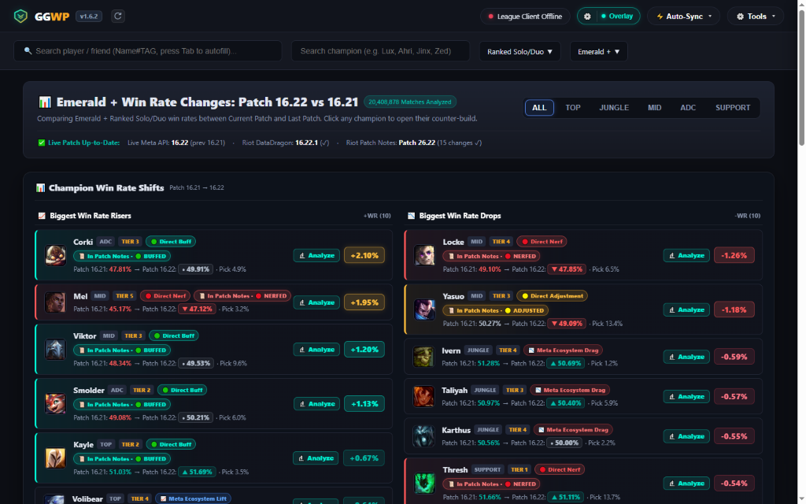

---

### 2. Role-Filtered Champion Search
Quickly search for any champion and filter by lane (`All`, `Top`, `Jungle`, `Mid`, `Bot`, `Sup`), sorted by **A–Z**, **Win Rate**, or **Pick Rate**. Opening a champion while a role filter is active automatically loads that role's build.

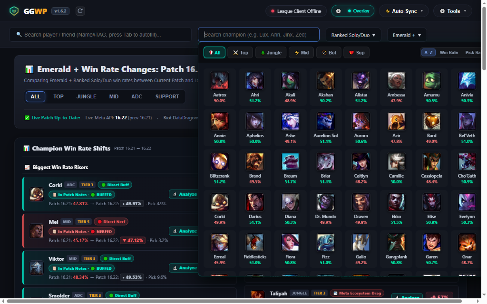

---

### 3. Champion Builds, Runes, Spells & Counter-Matchups
Browse top-performing rune pages, summoner spell combinations, 3/4/5-item core builds, situational counter items, and skill priority order.
- **One-Click Client Import**: Click any rune page, spell setup, or item build to import it directly into your League Client.
- **Smart Flash / Ghost Slot Placement**: Automatically places **Flash** (or **Ghost** when Flash isn't used) on your preferred `[D]` or `[F]` key.
- **Dynamic Counter-Matchups (Your Choice)**: Stay on the standard **All Matchups** build by default, click the highlighted **In Draft** enemy chip on demand, or enable **Auto-Lock Enemy Lane** / **Auto-Counter Matchup** to auto-switch to your predicted lane opponent.

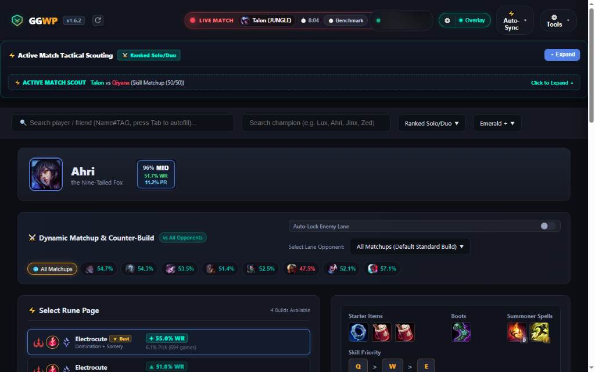

---

### 4. Color-Coded Abilities & Scaling
Inspect every champion ability (`Passive`, `Q`, `W`, `E`, `R`) with cooldowns, resource costs, and color-coded scalings (Physical, Magic, True Damage, Health/Shield, Armor, Magic Resist, Attack Speed/Crit, Mana, Move Speed).

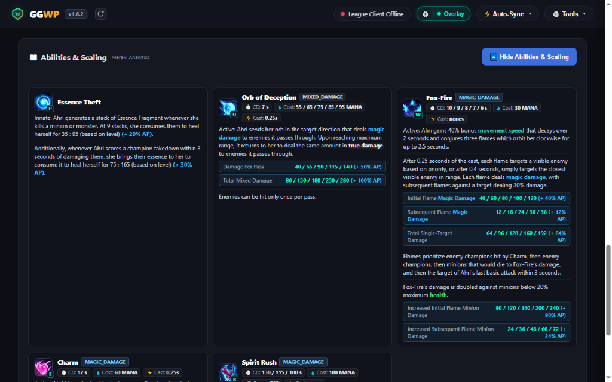

---

### 5. ARAM & ARAM: Mayhem Support
Dedicated build views for **ARAM** and **ARAM: Mayhem**, including **S / A / B-Tier Augment Priority** rankings and streamlined item builds.

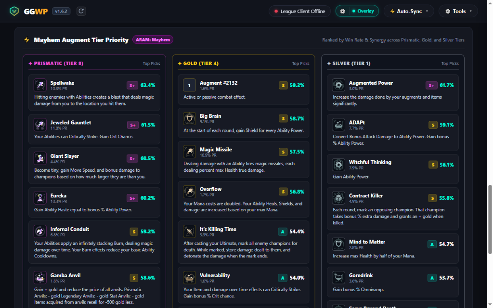

---

### 6. Live & Historical Performance Benchmark
Compare your minute-by-minute Gold, CS, and XP pace against rank benchmarks from Iron to Challenger, both during live matches and when reviewing past games.
- **Enemy R & Summoner Spell Cooldown Tracker**: Dynamically calculates enemy Ultimate (`R`) and Summoner Spell cooldowns (`Flash`, `Teleport`, `Ignite`, etc.) based on level, Ability Haste items, runes, and Hextech Drakes, with one-click manual countdown timers and clipboard timer sharing.

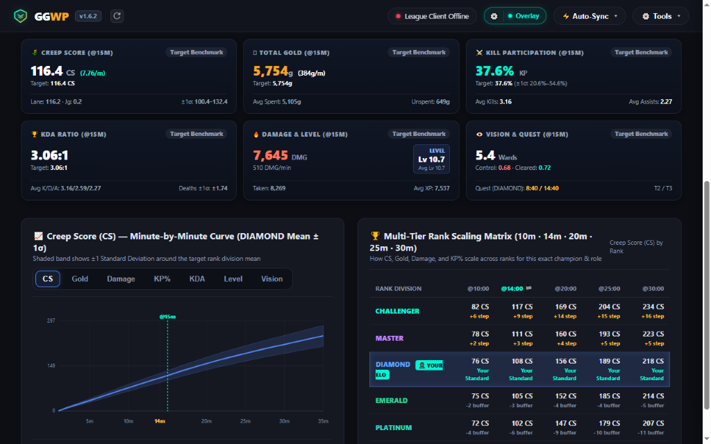

---

### 7. Post-Match Analyzer
Review 10-player performance scores, damage-type breakdowns, head-to-head lane matchup comparisons (`@14m` & full game), and team gold/XP momentum timelines after every match.

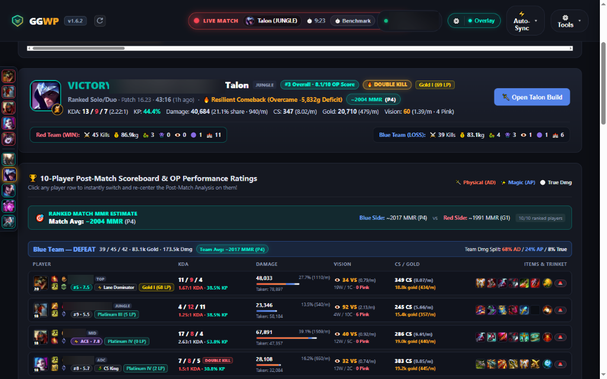

---

### 8. Personal Profile, Ranked LP Tracker & Match History
View your Solo/Duo and Flex rank, LP gains/losses, champion mastery, and mode-filterable match history, or look up other summoners across regions.

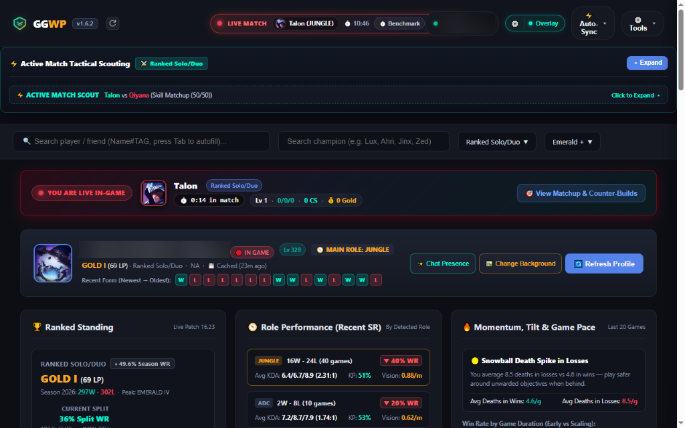

---

### 9. Auto-Sync & Tools Menus
Separate **Auto-Sync** and **Tools** menus keep automation and utilities organized:
- **⚡ Auto-Sync**: Auto-Accept Match, Auto-Import Runes, Auto-Import Spells, Auto-Import Items, Auto-Counter Matchup, Flash Slot (`[D]` / `[F]`), and Auto-Reject Scam Bots.
- **⚙️ Tools**: Live Benchmark, Pick/Ban Draft Scout, Post-Match Analyzer, In-Game Overlays, Check for Updates, Friend Requests & Scam Shield, Reports & Penalties Tracker, Custom Chat Presence, and Profile Background Skin.

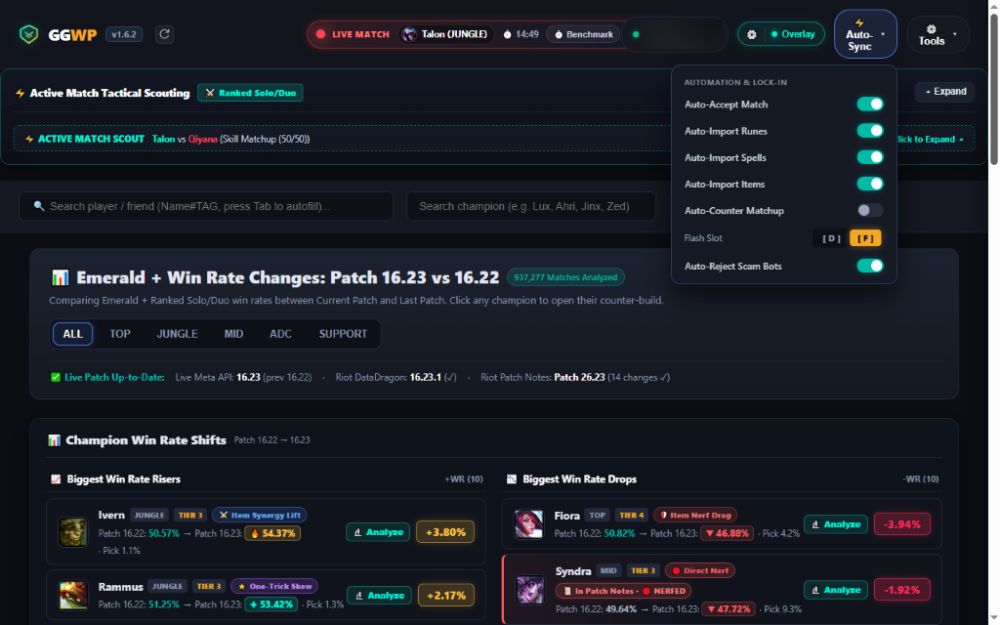

---

### 10. Click-Through In-Game Overlays
Lightweight, drag-to-reposition click-through overlays with adjustable opacity, featuring a live **Gold Diff Overlay** and **Enemy Draft Role Predictions**.

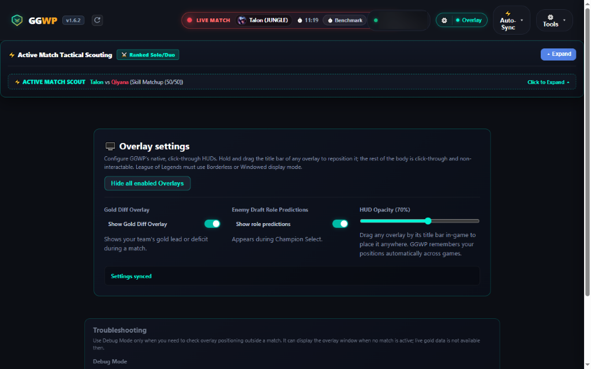

---

### 11. Live Draft Showdown & Recommended Picks
During Champion Select, preview all 5 lane-to-lane win rates, enemy team AD/AP/True damage balance, party premade indicators, and smart champion recommendations tailored to your lane matchup and full enemy comp.

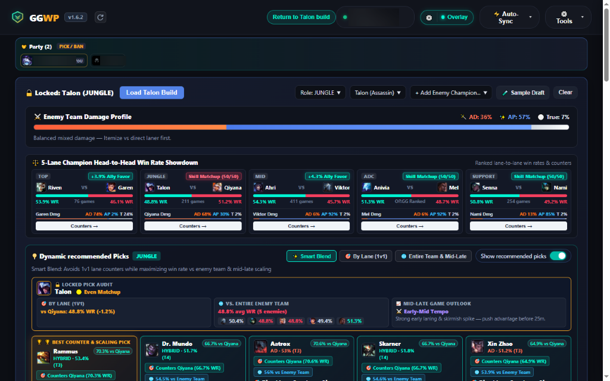

---

### 12. Live Match Tactical Scouting & 10-Player Tilt Heatmap
Get instant lane trading directives, cooldown-punish windows, objective power-spike alerts, and full 10-player scouting (seasonal win rates, premade duos, hot/cold streaks, comfort picks, KDA, and recent picks) as soon as the match starts.

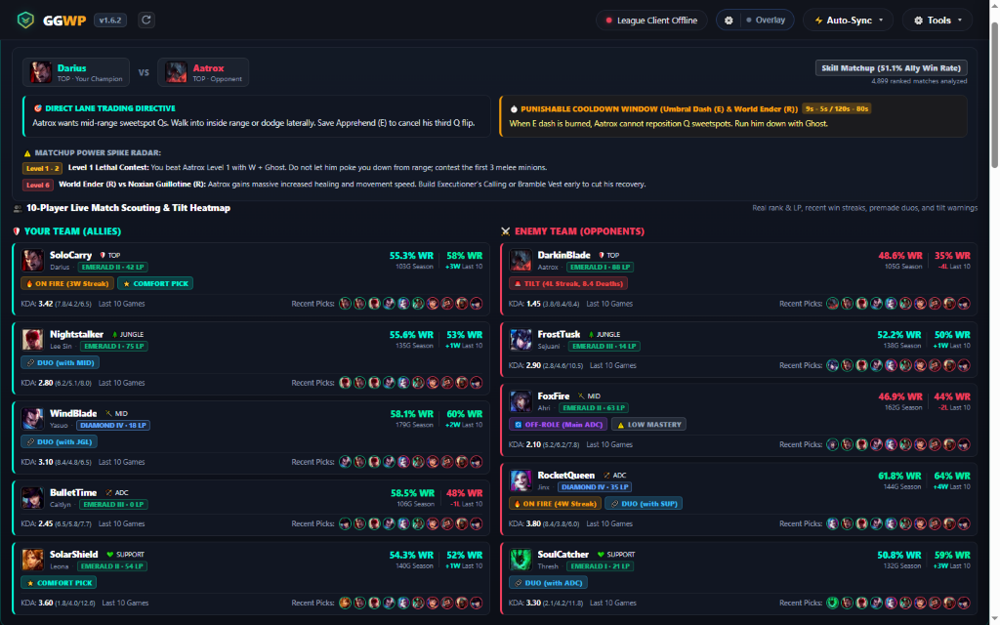
